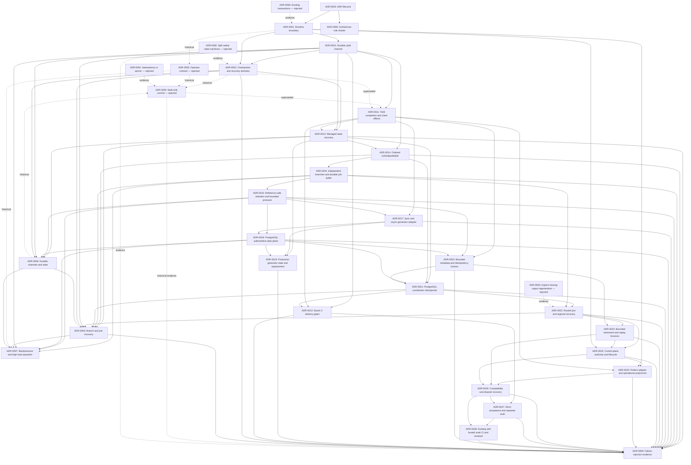

# Streaming ETL ADR graph

This directory is the decision log for the Ariadne streaming ETL runtime. ADR
files are immutable historical records: they are superseded or marked
`rejected`, never deleted.

## Status lifecycle

| Status | Meaning |
| --- | --- |
| `pending` | Created, but not yet discussed or tested. |
| `planning` | The direction is agreed for planning and implementation. |
| `progress` | The decision is being tested or implemented. |
| `accepted` | Production code exists and every acceptance criterion has evidence. |
| `rejected` | The theory failed review or validation; the ADR remains as evidence. |

No ADR in this graph is `accepted` yet. Passing a protocol prototype can move an
ADR to `planning` or `progress`; only production implementation plus acceptance
evidence can move it to `accepted`.

Protocol epoch 2 has earned 90% through R4-B. The gate evidence and remaining
production scope are recorded in
[ADR-0012](ADR-0012-protocol-epoch-2-delivery-gates.md).

## Decision graph

## ADRs

- [ADR-0000: Decision lifecycle and evidence](ADR-0000-decision-lifecycle.md) — `planning`
- [ADR-0001: Streaming runtime boundary](ADR-0001-runtime-boundary.md) — `progress`
- [ADR-0002: Barrier checkpoints and recovery domains](ADR-0002-checkpoints-and-recovery-domains.md) — `progress`
- [ADR-0003: Selective recovery through branches and joins](ADR-0003-branch-and-join-recovery.md) — `progress`
- [ADR-0004: Atomic outcome across multiple sinks](ADR-0004-multi-sink-commit.md) — `rejected`
- [ADR-0005: Replayable and idempotent operator contract](ADR-0005-operator-contract.md) — `rejected`
- [ADR-0006: Durable channels and state backend](ADR-0006-durable-channels-and-state.md) — `planning`
- [ADR-0007: Backpressure and high-load operation](ADR-0007-backpressure-and-high-load.md) — `pending`
- [ADR-0008: ETL Architect / HighLoad Principal role charter](ADR-0008-architecture-role-charter.md) — `planning`
- [ADR-0009: Failure-injection evidence](ADR-0009-failure-injection-evidence.md) — `progress`
- [ADR-0010: Platform-owned durable yield channel](ADR-0010-platform-durable-yield-channel.md) — `progress`
- [ADR-0011: Yield completion and client-owned effects](ADR-0011-yield-completion-and-client-effects.md) — `progress`
- [ADR-0012: Protocol epoch 2 delivery gates](ADR-0012-protocol-epoch-2-delivery-gates.md) — `planning`
- [ADR-0013: Managed state classes and recovery authority](ADR-0013-managed-state-recovery-classes.md) — `progress`
- [ADR-0014: Ordered DATA/BARRIER composition](ADR-0014-ordered-data-barrier-composition.md) — `progress`
- [ADR-0015: Independent branches and durable join buffer](ADR-0015-independent-branches-and-durable-join-buffer.md) — `progress`
- [ADR-0016: Reference-safe retention and bounded pressure](ADR-0016-reference-safe-retention-and-bounded-pressure.md) — `progress`
- [ADR-0017: Sync and async generator adapter](ADR-0017-sync-async-generator-adapter.md) — `progress`
- [ADR-0018: PostgreSQL authoritative data plane](ADR-0018-postgresql-authoritative-data-plane.md) — `progress`
- [ADR-0019: Production generator state and replacement](ADR-0019-production-generator-state-and-replacement.md) — `progress`
- [ADR-0020: Bounded metadata and idempotency horizon](ADR-0020-bounded-metadata-and-idempotency-horizon.md) — `progress`
- [ADR-0021: PostgreSQL coordinator checkpoints and frozen recovery plans](ADR-0021-postgresql-coordinator-checkpoints.md) — `progress`
- [ADR-0022: Routed barriers, durable join mailboxes, and regional recovery](ADR-0022-postgresql-routed-join-and-regional-recovery.md) — `progress`
- [ADR-0023: Bounded retention and explicit replay horizons](ADR-0023-bounded-retention-and-replay-horizons.md) — `progress`
- [ADR-0024: Control-plane projections, leadership and run lifecycle](ADR-0024-control-plane-authority-and-lifecycle.md) — `progress`
- [ADR-0025: Feature-flagged Prefect adapter and operational projections](ADR-0025-prefect-adapter-and-operational-projections.md) — `progress`
- [ADR-0026: Release compatibility and disaster recovery](ADR-0026-release-compatibility-and-disaster-recovery.md) — `progress`
- [ADR-0027: Short acceptance and a separate long soak](ADR-0027-short-acceptance-and-separate-long-soak.md) — `planning`
- [ADR-0028: Existing self-hosted soak CI and reviewer](ADR-0028-self-hosted-soak-ci-and-reviewer.md) — `progress`
- [ADR-0090: Use Prefect transactions as the streaming coordinator](ADR-0090-prefect-transactions-as-coordinator.md) — `rejected`
- [ADR-0091: Idempotency alone provides multi-sink atomicity](ADR-0091-idempotency-alone-is-atomic.md) — `rejected`
- [ADR-0092: Split lifecycle and progress state machines](ADR-0092-split-safety-state-machines.md) — `rejected`
- [ADR-0093: Implicit regeneration of missing durable output](ADR-0093-implicit-regeneration-of-missing-durable-output.md) — `rejected`

Delivery planning is tracked in [todo.md](../todo.md) and
[sprint_board.md](../sprint_board.md). Those files may change as work is sliced;
the decision history remains in ADRs.

